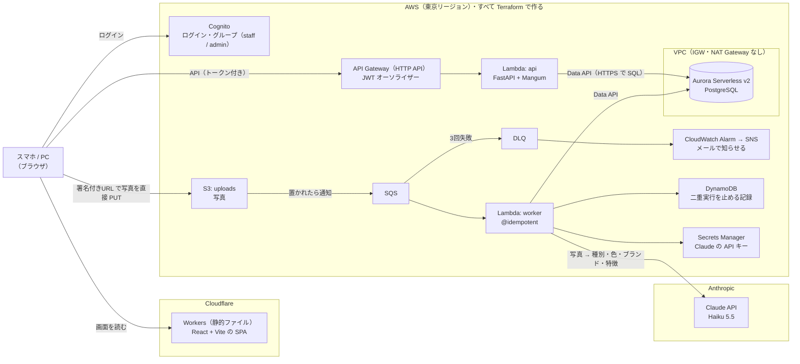

# photo-intake

**拾得物（落とし物）を写真で登録すると、AI が種別・色・ブランド・特徴を読み取って台帳にする、サーバーレスの管理システム。**

AWS のインフラはすべて Terraform で作っている。

- 画面：<https://photo-intake.nkn-ms.workers.dev>（ログインが要る。アカウントは配っていない）
- 構成図：<https://photo-intake.nkn-ms.workers.dev/architecture>（ログインなしで見られる）

## 動くもの

1. **スタッフが写真を撮って登録する。** 写真はブラウザの中で縮小し、撮影場所などの情報（EXIF）を消してから、
   署名付きURL（期限付きで S3 に置く許可）で **S3 に直接置く**。写真は API を通らない
2. **AI が写真を読む。** S3 → SQS → Lambda（worker）が Claude に写真を渡し、`{種別・色・ブランド・特徴}` を JSON で受け取って
   Aurora に保存する。状態は「確認待ち」
3. **一覧と詳細で確かめる。** 詳細では AI の答えと人が確定した値を並べ、違う項目に色を付ける
4. **admin が確定する。** 状態が「確定」になり、保管期限（拾得日 + 3か月。遺失物法の保管期間）が自動で入る
5. **失敗しても業務は止まらない。** 解析が3回失敗したら DLQ に移り、アラームがメールで知らせる。
   その行は「解析失敗」になり、画面から人が手で入力して確定できる

まだ作っていないもの（落とし主の問い合わせとのベクトル検索、LINE、CI）は [まだやっていないこと](#まだやっていないこと) に書いた。

## 構成



> 画面の `/architecture` も同じ図を出す（`frontend/src/architecture.mmd` を README と画面の両方で使っている）。

| 層 | 使っているもの |
|---|---|
| 画面 | React 19 + Vite + TypeScript、MUI、React Router |
| 画面の置き場所 | Cloudflare Workers（本来は CloudFront + S3。[理由](#今は代わりのものを使っているところ)） |
| 認証 | Cognito（グループ：staff / admin）、API Gateway の JWT オーソライザー |
| API | API Gateway（HTTP API）→ Lambda（Python 3.12・FastAPI + Mangum・Pydantic v2） |
| DB | Aurora Serverless v2（PostgreSQL）を Data API で使う。使われないときは自動で止まる |
| 非同期 | S3 イベント → SQS（+ DLQ）→ Lambda（worker）。二重実行は Powertools の `@idempotent` + DynamoDB で止める |
| AI | Claude API（Haiku 5.5）を直接呼ぶ（本来は Bedrock。[理由](#今は代わりのものを使っているところ)） |
| IaC | Terraform |
| テスト | pytest + moto（AWS に繋がずに動く）、mypy（strict）、ruff、Oxlint |

## 設計判断

### なぜ SQS を挟むのか
画像の AI 解析には数秒かかる。同期処理ではアップロード API がタイムアウトするか、
クライアントを待たせることになる。**アップロード完了の応答だけ即座に返し、解析は後ろで回す。**
この分離がこの構成の中心にある。


### なぜ Aurora Serverless v2 + Data API なのか
登録された物品と照会の突合が本質的な要件で、条件の組み合わせで絞り込むためアクセスパターンが
固定できない。よって RDB を選んだ。さらに `pgvector` でベクトル類似検索まで同じ DB で賄える。

通常 RDB を使うと連鎖でコストが増える。

```
RDB は VPC 内にしか置けない → Lambda を VPC に入れる
  → VPC 内の Lambda は既定で外に出られない
    → S3 / Bedrock / Claude API に届かせるため NAT Gateway（月 $45）が要る
```

**Data API は HTTPS で SQL を受けるため、Lambda を VPC の外に置いたまま DB を叩ける。**
結果として NAT Gateway も VPC エンドポイントも不要になる。
VPC は Aurora の置き場として作るが、IGW も NAT も置いていない。


### なぜ Lambda で、ECS Fargate ではないのか
実行が断続的でリクエスト数も少ないため、常時起動のコストが無駄になる。
**常時負荷があるなら Fargate を選ぶ。**


### 失敗したらどうなるか
SQS が3回リトライし、それでも失敗したメッセージは DLQ に退避する。
DLQ にメッセージが入ると CloudWatch Alarm が SNS 経由で通知する。
該当レコードは `analysis_failed` 状態になり、管理画面から手動入力に回せる。**業務は止まらない。**


### AI の出力を上書きしない
`ai_result` に AI の生出力を、別カラムに人が確定した内容を持つ。
**両方を残すことで「AI がどれだけ当たっていたか」を後から測れる。**
上書きしてしまうと精度が永久に測定できなくなる。


### 冪等性
SQS は at-least-once 配信なので、同じメッセージが複数回届きうる。
AWS Lambda Powertools の `@idempotent` が DynamoDB に実行済みキーを記録し、二重実行を防ぐ。


### DB の起動待ちは画面がする
Aurora は最後の SQL から5分で止まる設定にしている（`min_capacity = 0`。止まっている間はストレージ代だけ）。
止まった DB は起き上がるまで数十秒かかり、API Gateway の上限（約30秒）の中で Lambda が待つと、間に合わずに 500 になった。

そこで **Lambda は待たずに `503` と `Retry-After: 5` を返し、画面（`frontend/src/api.ts`）が5秒待って出し直す**（最大90秒）。
待つ役を、時間の上限が無い側に移した。

**切り替える条件：** 使う時間帯に待たせられないなら、最小容量を 0.5 ACU にして止めない。そのぶん、止まらない時間の料金がかかる。

### 画面は SPA（React + Vite）にした
ログインした社内のスタッフだけが使う画面で、SSR も SEO も要らない。ビルドした静的なファイルを置くだけで動くので、
画面のためのサーバーを持たずに済む。

> 途中まで Vue 3 で作り、React に戻した。Vue 版は `frontend-vue/` に参考として残している（ビルド・公開はしない）。

### 今は代わりのものを使っているところ
AWS アカウントの確認が済むまで、2か所を AWS の外のサービスで代わりにしている。**どちらも Terraform の変数1つで元に戻せる。**

| | 本来 | 今 | 代わりにしている理由 | 元に戻す方法 |
|---|---|---|---|---|
| 画面の置き場所 | CloudFront + S3（OAC で S3 は非公開のまま） | Cloudflare Workers（静的ファイル） | アカウントの確認が済むまで CloudFront を作れない | `enable_cloudfront = true` で `make apply` し、ビルドした画面を S3 に置く（Terraform は書いてある） |
| AI | Bedrock（Claude） | Claude API（Anthropic）を直接 | アカウント全体で Bedrock が止められている（サポートに問い合わせ中） | `analyzer = "bedrock"` |

**本番では Bedrock にする。** Claude API を直接呼ぶと、写真が AWS の外（Anthropic）に出る。
Bedrock なら AWS の中で済み、IAM のロールで呼べるので、API キーを持つ必要も無くなる。
今の API キーは Secrets Manager に置き、Terraform の state にもコードにも入れていない（値は作者がターミナルから直接入れた）。

### Claude API は SDK を使わず、標準ライブラリで呼ぶ
呼ぶのは「写真1枚と質問を送って、答えをもらう」1種類だけなので、Python の `urllib` で POST を1本送っている。
SDK を Lambda の zip に詰める手間をかけない。**ストリーミングやツールなど、呼び方が増えたら公式の SDK に替える。**

### CORS
今は画面（`*.workers.dev`）と API（`*.execute-api.amazonaws.com`）のドメインが違うので、API Gateway と S3 に CORS の設定がある
（許すドメインは Terraform に書いている）。**CloudFront に戻したら、`/api/*` を API Gateway に回す設定を足して同じドメインにすれば、API の CORS は要らなくなる。**
S3 の CORS は残る。写真は署名付きURL で S3 のドメインに直接置くので、画面とはどうしてもドメインが違う。

### state 管理
Terraform の state は**今はローカル**（`infra/envs/dev/terraform.tfstate`。gitignore 済み）。一人で作っている間はこれで足りる。
**CI（GitHub Actions）から plan / apply する前に、S3 に移す。** ローカルのままだと ①CI から読めない
②他の人の変更を上書きしうる ③消えたら復旧できない。ロックは S3 のネイティブロック（`use_lockfile`）を使う予定
（Terraform 1.11 から DynamoDB のロックは非推奨）。

### drift（コードと実物のズレ）
コンソールで手作業をすると `terraform plan` に差分として現れる。
**手で直さず、コードを直す運用にしている。**


## セキュリティ

- **写真は公開しない。** S3 はパブリックアクセスを全部ブロックし、置くのも見るのも**5分で切れる署名付きURL**だけ。
  HTTP（暗号化なし）のリクエストはバケットのポリシーで断る
- **撮影場所を残さない。** 写真の EXIF（位置情報など）は、送る前にブラウザの中で消す
- **認証は API Gateway、認可は API。** ログインしているか（Cognito の JWT）は API Gateway が Lambda の手前で確かめる。
  admin だけの操作（確定）は API が確かめて 403 を返す。画面でボタンを隠すのは見た目の都合にすぎない
- **長期のアクセスキーを使わない。** 人は IAM Identity Center の一時認証情報、Lambda などはすべて IAM ロール
- **パスワードとキーをコードにも state にも置かない。** DB のパスワードは AWS に作らせる（`manage_master_user_password`）。
  Claude の API キーは Secrets Manager に置き、値は作者がターミナルから直接入れた。読めるのは worker のロールだけ
- **残っている弱いところ：** ログインのトークンはブラウザの localStorage にある（Amplify の既定）。XSS があれば盗まれうる。
  React は文字を自動でエスケープするので、人が入れた文字を HTML として入れる箇所は無い。次は CSP を足す。
  もっと固くするなら、トークンを httpOnly の Cookie に入れ、API の手前に BFF を置く

## コスト

| 状態 | かかるもの |
|---|---|
| 使っていない間 | Secrets Manager（$0.40/月）・CloudWatch Alarm（$0.10/月）・Aurora のストレージ。Aurora は最後の SQL から5分で止まり、止まっている間の計算の料金はかからない |
| 使っている間 | 上に加えて Aurora の稼働時間（0〜1 ACU）。Lambda・API Gateway・SQS・S3・DynamoDB は使った分だけで、この量ならほぼ $0 |
| AI | 写真1枚あたり約 $0.0004（実測：入力 2,553・出力 371 トークン、Haiku 5.5） |
| `make destroy` 済み | **$0** |

月 $10 を超えたらメールが届くように、AWS Budgets を設定している。

## 使い方

初めて作るとき：

```bash
cp infra/envs/dev/terraform.tfvars.example infra/envs/dev/terraform.tfvars  # アラームの宛先のメールを書く
make login     # AWS にログイン（IAM Identity Center）
make init
make apply     # AWS に作る
make migrate   # DB に表を作る

# Claude の API キーを入れる（キーを画面に出さず、シェルの履歴にも残さない）
read -s KEY && AWS_PROFILE=photo-intake aws secretsmanager put-secret-value \
  --secret-id photo-intake-dev/anthropic-api-key --secret-string "$KEY" && unset KEY

make user EMAIL=you@example.com GROUP=admin   # ログインする人を作る（GROUP は staff か admin）
make web-env                                  # 画面が使う値を frontend/.env.local に書き出す
cd frontend && npm install && npm run dev     # http://localhost:5173
make deploy-web                               # 画面を Cloudflare Workers に公開する
```

ふだん使うもの：

```bash
make plan      # 何が変わるかを見るだけ（変更しない）
make apply     # AWS に反映
make destroy   # 作ったものを全部消す（S3 に写真があれば先に make empty-bucket）

make items     # 最近登録した5件
make peek      # SQS と DLQ の中身を覗く（消さない）
make sql SQL="SELECT status, count(*) FROM items GROUP BY status"

cd backend && uv run pytest && uv run mypy && uv run ruff check .   # AWS に繋がずに動く
cd frontend && npx tsc -b && npx oxlint
```

ほかのコマンドは Makefile を見る（各行の `##` の後ろが説明）。

## ディレクトリ

```
infra/envs/dev/      Terraform（root module。terraform はここで実行する）
backend/
├── api/             API の Lambda（FastAPI）
├── worker/          解析の Lambda
├── migrations/      DB の表（SQL）
└── tests/           pytest + moto
frontend/            画面（React）
frontend-vue/        Vue 版（参考。ビルド・公開はしない）
docs/
└── idempotency-by-hand.md   Powertools を使わずに書いた冪等性（Powertools が中でしていることを理解するため）
```

ディレクトリは**中身ができた時点で作る。** 空のディレクトリを先に置くと、
リポジトリが「あるはずのもの」について嘘をつくため。

## まだやっていないこと

- **落とし主の問い合わせとの照合：** 問い合わせの自由文と拾得物を埋め込み（ベクトル）にして、pgvector で近いものを探す
- **LINE：** スタッフが LINE で写真を送ると拾得物として登録する（S3 に置けば後ろの流れは同じ）。
  解析が終わったら、落とし物の知らせ用の LINE グループに「休憩室に鍵の忘れ物がありました」のように届ける。
  落とし主への知らせは優先度を下げている
- **CI：** GitHub Actions + OIDC（キーを持たない）。PR に `terraform plan` の結果を出し、merge で apply。その前に state を S3 に移す
- **本来の形に戻す：** CloudFront（`enable_cloudfront`）と Bedrock（`analyzer = "bedrock"`）。AWS アカウントの確認が済んだら
- **保管期限が過ぎた後：** 警察への届出・処分の状態と画面
- **CSP**（上のセキュリティの節）
