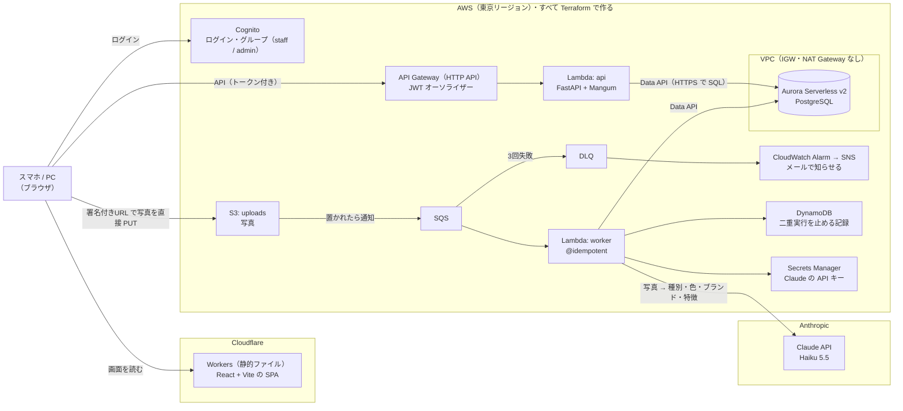

# photo-intake

**拾得物（落とし物）を写真で登録すると、AI が種別・色・ブランド・特徴を読み取って台帳にする、サーバーレスの管理システム。**

AWS のインフラはすべて Terraform で作っている。

- 画面：<https://photo-intake.nkn-ms.workers.dev>（ログインが要る。アカウントは配っていない）
- 構成図：<https://photo-intake.nkn-ms.workers.dev/architecture>（ログインなしで見られる）

## 動くもの

1. **スタッフが写真を撮って登録する。** 写真はブラウザの中で縮小し、撮影場所などの情報（EXIF）を消してから、
   署名付きURL（期限付きで S3 に置く許可）で **S3 に直接置く**。写真は API を通らない
2. **AI が写真を読む。** S3 → SQS → Lambda（worker）が Claude に写真を渡し、`{種別・色・ブランド・特徴}` を JSON で受け取って
   Aurora に保存する。状態は「確認待ち」
3. **一覧と詳細で確かめる。** 詳細では AI の答えと人が確定した値を並べ、違う項目に色を付ける
4. **admin が確定する。** 状態が「確定」になり、保管期限（拾得日 + 3か月。遺失物法の保管期間）が自動で入る
5. **失敗しても業務は止まらない。** 解析が3回失敗したら DLQ に移り、アラームがメールで知らせる。
   その行は「解析失敗」になり、画面から人が手で入力して確定できる

まだ作っていないもの（落とし主の問い合わせとのベクトル検索、LINE、CI）は [まだやっていないこと](#まだやっていないこと) に書いた。

## 構成



> 画面の `/architecture` も同じ図を出す（`frontend/src/architecture.mmd` を README と画面の両方で使っている）。

| 層 | 使っているもの |
|---|---|
| 画面 | React 19 + Vite + TypeScript、MUI、React Router |
| 画面の置き場所 | Cloudflare Workers（本来は CloudFront + S3。[理由](#今は代わりのものを使っているところ)） |
| 認証 | Cognito（グループ：staff / admin）、API Gateway の JWT オーソライザー |
| API | API Gateway（HTTP API）→ Lambda（Python 3.12・FastAPI + Mangum・Pydantic v2） |
| DB | Aurora Serverless v2（PostgreSQL）を Data API で使う。使われないときは自動で止まる |
| 非同期 | S3 イベント → SQS（+ DLQ）→ Lambda（worker）。二重実行は Powertools の `@idempotent` + DynamoDB で止める |
| AI | Claude API（Haiku 5.5）を直接呼ぶ（本来は Bedrock。[理由](#今は代わりのものを使っているところ)） |
| IaC | Terraform |
| テスト | pytest + moto（AWS に繋がずに動く）、mypy（strict）、ruff、Oxlint |

## 設計判断

### なぜ SQS を挟むのか
画像の AI 解析には数秒かかる。同期処理ではアップロード API がタイムアウトするか、
クライアントを待たせることになる。**アップロード完了の応答だけ即座に返し、解析は後ろで回す。**
この分離がこの構成の中心にある。

### なぜ Aurora Serverless v2 + Data API なのか
登録された物品と照会の突合が本質的な要件で、条件の組み合わせで絞り込むためアクセスパターンが
固定できない。よって RDB を選んだ。さらに `pgvector` でベクトル類似検索まで同じ DB で賄える。

通常 RDB を使うと連鎖でコストが増える。

```
RDB は VPC 内にしか置けない → Lambda を VPC に入れる
  → VPC 内の Lambda は既定で外に出られない
    → S3 / Bedrock / 外部 API に届かせるため NAT Gateway（月 $45）が要る
```

**Data API は HTTPS で SQL を受けるため、Lambda を VPC の外に置いたまま DB を叩ける。**
結果として NAT Gateway も VPC エンドポイントも不要になる。
VPC は Aurora の置き場として作るが、IGW も NAT も置いていない。

### なぜ Lambda で、ECS Fargate ではないのか
実行が断続的でリクエスト数も少ないため、常時起動のコストが無駄になる。
**常時負荷があるなら Fargate を選ぶ。**

### 失敗したらどうなるか
SQS が3回リトライし、それでも失敗したメッセージは DLQ に退避する。
DLQ にメッセージが入ると CloudWatch Alarm が SNS 経由で通知する。
該当レコードは `analysis_failed` 状態になり、管理画面から手動入力に回せる。**業務は止まらない。**

### AI の出力を上書きしない
`ai_result` に AI の生出力を、別カラムに人が確定した内容を持つ。
**両方を残すことで「AI がどれだけ当たっていたか」を後から測れる。**
上書きしてしまうと精度が永久に測定できなくなる。

### 冪等性
SQS は at-least-once 配信なので、同じメッセージが複数回届きうる。
AWS Lambda Powertools の `@idempotent` が DynamoDB に実行済みキーを記録し、二重実行を防ぐ。

### state 管理
tfstate は S3 に置き、S3 ネイティブロック（`use_lockfile`）で同時実行を防ぐ。
ローカルに置くと ①他人の変更を上書きする ②失うと復旧できない ③CI から触れない。

> Terraform 1.11 で `dynamodb_table` によるロックが非推奨になったため、ロック専用テーブルは持たない。

### drift（コードと実物のズレ）
コンソールで手作業をすると `terraform plan` に差分として現れる。
**手で直さず、コードを直す運用にしている。**

## セキュリティ

- 画像には個人情報が写りうるため、**S3 はパブリックアクセスを全ブロック**。
  閲覧・アップロードは**有効期限付きの署名付き URL** のみ
- 認証情報は長期のアクセスキーを使わず、**IAM Identity Center の一時認証情報**を使う
- DB のパスワードは Terraform が値を知らない（`manage_master_user_password` で
  AWS 側に生成させる）ため、**コードにも state にも平文で現れない**

## コスト

| 状態 | 月額 |
|---|---|
| `make destroy` 済み | **$0** |
| 稼働中 | 実測値を追記予定 |

Aurora Serverless v2 は最小容量 0 ACU（自動一時停止）に設定しているため、
無通信が続けばコンピュート課金は止まる。使わない期間は `make destroy` で消す。

## 使い方

```bash
make whoami    # どのアカウント・どのロールで作業しているか確認
make login     # 認証セッションが切れたら

make fmt       # 整形
make validate  # 文法と参照の検査（AWS に触らない）

make init      # provider の準備
make plan      # 差分の表示（何も変更しない）
make apply     # AWS に反映
make destroy   # 作ったものを消す
```

## 構成

```
infra/
└── envs/dev/          root module。terraform はここで実行する
backend/
└── migrations/        DB スキーマ
```

ディレクトリは**中身ができた時点で作る。** 空のディレクトリを先に置くと、
リポジトリが「あるはずのもの」について嘘をつくため。
