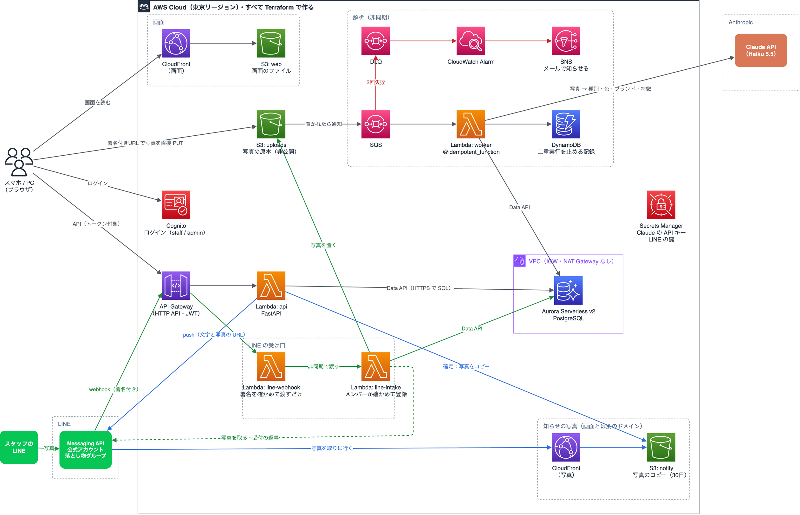

# photo-intake

**拾得物（落とし物）を写真で登録すると、AI が種別・色・ブランド・特徴を読み取って台帳にする、サーバーレスの管理システム。**

AWS のインフラはすべて Terraform で作っている。

- 画面：<https://d2mdm2i9qildnx.cloudfront.net>（ログインが要る。アカウントは配っていない）
- 構成図：<https://d2mdm2i9qildnx.cloudfront.net/architecture>（ログインなしで見られる）

## 処理の流れ

1. **スタッフが写真を撮って登録する。** 入口は2つある。
   - **画面から：** 写真はブラウザの中で縮小し、撮影場所などの情報（EXIF）を消してから、
     署名付きURL（期限付きで S3 に置く許可）で **S3 に直接置く**。写真は API を通らない
   - **LINE から：** スタッフ用の LINE 公式アカウントに、1対1のトークで写真を送る。送り主が落とし物グループのメンバーなら、
     写真を LINE から取ってきて S3 に置き、「写真を受け付けました」と返す
2. **AI が写真を読む。** 写真が S3 に置かれると、SQS を通して Lambda（worker）が起動する。worker は写真を Claude に渡し、
   `{種別・色・ブランド・特徴}` を JSON で受け取って Aurora に保存する。状態は「確認待ち」。**入口が2つでも、ここから後ろは同じ**
3. **一覧と詳細で確かめる。** 詳細では AI の答えと人が確定した値を並べ、違う項目に色を付ける
4. **admin が確定する。** 状態が「確定」になり、保管期限（拾得日 + 3か月）が自動で入る。
   あわせて、**落とし物グループに LINE で写真付きの知らせが届く**（「落とし物のお知らせ／種別：財布…」と写真）
5. **失敗しても業務は止まらない。** 解析が失敗した行は「解析失敗」になり、画面から人が手で入力して確定できる。
   一時的な失敗は3回までやり直し、それでも駄目ならアラームがメールで知らせる（[詳しく](#失敗したらどうなるか)）

まだ作っていないもの（落とし主の問い合わせ、ベクトル検索、CI）は [まだやっていないこと](#まだやっていないこと) に書いた。

## 構成



矢印の色：灰＝画面から・緑＝LINE から登録・青＝確定したら知らせる・赤＝失敗したとき。

> 図は draw.io で描いている（`docs/architecture.drawio`）。`make diagram` で PNG に書き出し、README と画面の `/architecture` の両方で同じ画像を使う。

### S3 のバケット

見せ方（公開・非公開）が違うものは、バケットを分けている（[理由](#知らせの写真は別のバケットと別のドメインから出す)）。

| バケット | 置くもの | 書く | 読む | 公開 |
|---|---|---|---|---|
| uploads | 写真の原本（画面と LINE から登録したもの） | スタッフ（署名付きURL）、line-intake | worker（AI の解析）、管理画面（5分の署名付きURL） | しない |
| web | 画面のファイル（index.html、JS、CSS） | `make deploy-web` | だれでも（画面用の CloudFront を通して） | CloudFront を通してだけ |
| notify | LINE の知らせに付ける写真のコピー（30日で消える） | API（確定のとき） | だれでも（写真用の CloudFront を通して。URL が出るのは落とし物グループの中だけ） | CloudFront を通してだけ。画面とは別のドメイン |


| 層 | 使っているもの |
|---|---|
| 画面 | React 19 + Vite + TypeScript、MUI、React Router |
| 画面の置き場所 | CloudFront + S3（OAC で S3 は非公開のまま） |
| 認証 | Cognito（グループ：staff / admin）、API Gateway の JWT オーソライザー |
| API | API Gateway（HTTP API）→ Lambda（Python 3.12・FastAPI + Mangum・Pydantic v2） |
| DB | Aurora Serverless v2（PostgreSQL）を Data API で使う。使われないときは自動で止まる |
| 非同期 | S3 イベント → SQS（+ DLQ）→ Lambda（worker）。二重実行は Powertools の `@idempotent_function` + DynamoDB で止める |
| AI | Claude API（Haiku 5.5）を直接呼ぶ（本来は Bedrock。[理由](#今は代わりのものを使っているところ)） |
| LINE | Messaging API。受け口は API Gateway → Lambda（line-webhook → line-intake）、知らせは API から push |
| IaC | Terraform |
| テスト | pytest + moto（AWS に繋がずに動く）、mypy（strict）、ruff、Oxlint |

## 設計判断

### なぜ SQS を挟むのか
画像の AI 解析には数秒かかる。登録の API の中で解析までやると、その間スタッフを待たせることになり、
AI が混んで遅れれば API Gateway の上限（約30秒）でタイムアウトする。
**登録の API は署名付きURL を返してすぐ終わり、解析は写真が S3 に置かれてから後ろで回す。**
この分離がこの構成の中心にある。


### なぜ Aurora Serverless v2 + Data API なのか
本題は、拾得物と落とし主の問い合わせを照らし合わせること（これから作る）。種別・色・場所・日付などの
組み合わせで絞り込むので、読み方（アクセスパターン）を前もって決めきれない。よって RDB を選んだ。
PostgreSQL なら、照合に使うベクトル類似検索も `pgvector` で同じ DB に足せる（これも、これから作る）。

通常 RDB を使うと連鎖でコストが増える。

```
RDB は VPC 内にしか置けない → Lambda を VPC に入れる
  → VPC 内の Lambda は既定で外に出られない
    → S3 / Bedrock / Claude API に届かせるため NAT Gateway（月 $45）が要る
```

**Data API は HTTPS で SQL を受けるため、Lambda を VPC の外に置いたまま DB を叩ける。**
結果として NAT Gateway も VPC エンドポイントも不要になる。
VPC は Aurora の置き場として作るが、IGW も NAT も置いていない。


### なぜ Lambda で、ECS Fargate ではないのか
実行が断続的でリクエスト数も少ないため、常時起動のコストが無駄になる。
**常時負荷があるなら Fargate を選ぶ。**


### 失敗したらどうなるか
失敗を、やり直して意味があるかどうかで2種類に分けている。

- **やり直しても結果が変わらない失敗**（対応していない画像の形式、AI の答えが JSON として読めない、AI が受け付けない画像、など）：
  その場で `analysis_failed` にして終える。やり直さず、DLQ にも入れない
- **一時的な失敗**（AI の混雑、通信の失敗、DB の起動待ち、など）：SQS が3回まで配り直す。
  3回目も失敗したら `analysis_failed` を書いてから DLQ に移す。DLQ にメッセージが入ると CloudWatch Alarm が SNS 経由でメールを送る

どちらの場合も行は `analysis_failed` になり、管理画面から手で入力して確定できる。**業務は止まらない。**


### LINE の受け口は、関数を2つに分ける
LINE の webhook は、200 を早く返さないと「届かなかった」とみなされる。写真を LINE から取ってきて DB と S3 に書くのは時間がかかるので、
**受け口（line-webhook）は署名を確かめてイベントを非同期で渡すだけにし、重い処理は line-intake がする。**

分けると**権限も分けられる。** インターネットに開いている受け口が持つのは、チャネルシークレットを読む権限と、line-intake を呼ぶ権限だけ。
DB にも S3 にも触れない。line-intake が失敗したら、Lambda が自動で2回やり直す。同じ写真を2回登録しないように、
S3 のキーを LINE のメッセージ ID から決め、DB には `ON CONFLICT DO NOTHING` で入れる。

だれが写真を登録してよいかは、**落とし物グループのメンバーかどうか**で決める（LINE の API で確かめる）。
スタッフの ID の一覧は持たないので、人の出入りは LINE の中（グループに招待する・外す）で済む。

受け口のコード（`backend/line/webhook.py`）は、署名を確かめる鍵と渡す先を環境変数で受け取る。
公式アカウントを増やすとき（落とし主の問い合わせ用など）も、同じコードをもう1つ置けばよい。

### 知らせの写真は、別のバケットと別のドメインから出す
LINE の画像メッセージは、写真の URL を送り、LINE のサーバーがその URL から取りに行く。だから**ログインなしで開ける HTTPS の URL** が要る。
S3 の署名付きURL は、Lambda のロールの一時的な認証で署名するので数時間で切れ、過去の知らせの写真が開けなくなる。

そこで確定したときに、写真を notify バケットにコピーし、写真用の CloudFront の URL を送る。

- **コピーするのは、確定して知らせた写真だけ。** 確定前の写真や、解析に失敗した写真は出ない
- **名前は落とし物の ID**（DB がランダムに作る UUID）。1つの URL から、ほかの写真の URL は推し量れない。原本と突き合わせられる
- **30日で消える**（S3 のライフサイクルの決まり）
- **画面とは、バケットも CloudFront（ドメイン）も分ける。** ブラウザは、同じドメインから来たものを同じ仲間として扱う。
  利用者が送ったファイルが管理画面と同じドメインから出ると、写真のふりをした HTML や SVG が開かれたときに、
  中の JavaScript が管理画面の権限で動きうる。ドメインを分ければ、そうなっても管理画面には触れない
- **Content-Type は拡張子から決めて付け直す**（`image/jpeg` か `image/png`）。CloudFront は `X-Content-Type-Options: nosniff` を付けて返す

**割り切り：** URL を知っている人は、30日間はログインなしで写真を見られる。URL が出るのは落とし物グループの中だけ。
**切り替える条件：** 1日に1,000枚を超えるような規模になったり、写真を消す依頼に確実に応える必要が出たりしたら、
コピーをやめて、原本に CloudFront の署名付きURL（期限付き）を出す形にする。写真が1枚で済み、原本を消せば知らせの写真も開けなくなる。

### 知らせは、確定の書き込みが成功した後に送る
先に送ってから確定が失敗すると、確定していない落とし物を知らせてしまう。
**知らせに失敗しても、確定は成功のまま返す。** LINE の不調で確定の操作ができなくなるほうが困るため。失敗はログに残す。

### AI の出力を上書きしない
`ai_result` に AI の生出力を、別カラムに人が確定した内容を持つ。
**両方を残すことで「AI がどれだけ当たっていたか」を後から測れる。**
上書きしてしまうと精度が永久に測定できなくなる。


### 冪等性
SQS は at-least-once 配信なので、同じメッセージが複数回届きうる。
AWS Lambda Powertools の `@idempotent_function` が DynamoDB に実行済みキーを記録し、二重実行を防ぐ。


### DB の起動待ちは画面がする
Aurora は最後の SQL から5分で止まる設定にしている（`min_capacity = 0`。止まっている間はストレージ代だけ）。
止まった DB は起き上がるまで数十秒かかり、API Gateway の上限（約30秒）の中で Lambda が待つと、間に合わずに 500 になった。

そこで **Lambda は待たずに `503` と `Retry-After: 5` を返し、画面（`frontend/src/api.ts`）が5秒待って出し直す**（最大90秒）。
待つ役を、時間の上限が無い側に移した。

**切り替える条件：** 使う時間帯に待たせられないなら、最小容量を 0.5 ACU にして止めない。そのぶん、止まらない時間の料金がかかる。

### 画面は SPA（React + Vite）にした
ログインした社内のスタッフだけが使う画面で、SSR も SEO も要らない。ビルドした静的なファイルを置くだけで動くので、
画面のためのサーバーを持たずに済む。

> 途中まで Vue 3 で作り、React に戻した。Vue 版は `frontend-vue/` に参考として残している（ビルド・公開はしない）。

### 今は代わりのものを使っているところ
AWS アカウントの制限で使えない間、AI を AWS の外のサービスで代わりにしている。
本来の形のコードも Terraform も残してあり、切り替えは変数で選ぶ。

> 画面も、CloudFront を作れなかった間は Cloudflare Workers に置いていた。アカウントの確認が済んだので、2026-10-20 に CloudFront + S3 に戻した。

| | 本来 | 今 | 代わりにしている理由 | 元に戻す方法 |
|---|---|---|---|---|
| AI | Bedrock | Claude API（Anthropic）を直接 | アカウント全体で Bedrock が止められている（サポートに問い合わせ中） | `analyzer = "bedrock"`。既定のモデルは Amazon Nova 2 Lite。Claude にするには `vision_model_id` を替え、Anthropic のモデルの利用申請も要る（Haiku 5.5 なら、Bedrock 側の呼び方も temperature を送らない形に直す） |

**本番では Bedrock にする。** Claude API を直接呼ぶと、写真が AWS の外（Anthropic）に出る。
Bedrock なら AWS の中で済み、IAM のロールで呼べるので、API キーを持つ必要も無くなる。
今の API キーは Secrets Manager に置き、Terraform の state にもコードにも入れていない（値は作者がターミナルから直接入れた）。

### Claude API は SDK を使わず、標準ライブラリで呼ぶ
呼ぶのは「写真1枚と質問を送って、答えをもらう」1種類だけなので、Python の `urllib` で POST を1本送っている。
SDK を Lambda の zip に詰める手間をかけない。**ストリーミングやツールなど、呼び方が増えたら公式の SDK に替える。**

### CORS
今は画面（`*.cloudfront.net`）と API（`*.execute-api.amazonaws.com`）のドメインが違うので、API Gateway と S3 に CORS の設定がある
（許すドメインは Terraform が CloudFront の URL から作る）。**CloudFront に `/api/*` を API Gateway に回す設定を足して同じドメインにすれば、API の CORS は要らなくなる。**
S3 の CORS は残る。写真は署名付きURL で S3 のドメインに直接置くので、画面とはどうしてもドメインが違う。

### state 管理
Terraform の state は**今はローカル**（`infra/envs/dev/terraform.tfstate`。gitignore 済み）。一人で作っている間はこれで足りる。
**CI（GitHub Actions）から plan / apply する前に、S3 に移す。** ローカルのままだと ①CI から読めない
②他の人の変更を上書きしうる ③消えたら復旧できない。ロックは S3 のネイティブロック（`use_lockfile`）を使う予定
（Terraform 1.11 から DynamoDB のロックは非推奨）。

### drift（コードと実物のズレ）
コンソールで手作業をすると `terraform plan` に差分として現れる。
**手で直さず、コードを直す運用にしている。**


## セキュリティ

- **写真の原本は公開しない。** S3 はパブリックアクセスを全部ブロックし、置くのも見るのも**5分で切れる署名付きURL**だけ。
  HTTP（暗号化なし）のリクエストはバケットのポリシーで断る。LINE の知らせに出すのは、確定した写真のコピーだけ（30日・別のドメイン。[詳しく](#知らせの写真は別のバケットと別のドメインから出す)）
- **S3 は直接公開しない。** 画面と知らせの写真も、S3 はパブリックアクセスを全部ブロックしたまま、CloudFront だけに読ませる（OAC）。
  CloudFront はセキュリティのヘッダー（`nosniff`、HSTS、`X-Frame-Options` など）を付けて返す
- **LINE からのリクエストは、署名を確かめる。** 受け口は、LINE のチャネルシークレットで作った署名（HMAC-SHA256）が合わなければ 401 で断る
- **撮影場所を残さない。** 写真の EXIF（位置情報など）は、送る前にブラウザの中で消す
- **認証は API Gateway、認可は API。** ログインしているか（Cognito の JWT）は API Gateway が Lambda の手前で確かめる。
  admin だけの操作（確定）は API が確かめて 403 を返す。画面でボタンを隠すのは見た目の都合にすぎない
- **長期のアクセスキーを使わない。** 人は IAM Identity Center の一時認証情報、Lambda などはすべて IAM ロール
- **パスワードとキーをコードにも state にも置かない。** DB のパスワードは AWS に作らせる（`manage_master_user_password`）。
  Claude の API キーと LINE の鍵（チャネルシークレット・アクセストークン）は Secrets Manager に置き、値は作者がターミナルから直接入れた。
  Terraform が作るのは入れ物だけ。それぞれの鍵を読めるのは、使う Lambda のロールだけ
- **残っている弱いところ：** ログインのトークンはブラウザの localStorage にある（Amplify の既定）。XSS があれば盗まれうる。
  React は文字を自動でエスケープするので、人が入れた文字を HTML として入れる箇所は無い。次は CSP を足す。
  もっと固くするなら、トークンを httpOnly の Cookie に入れ、API の手前に BFF を置く

## コスト

| 状態 | かかるもの |
|---|---|
| 使っていない間 | Secrets Manager（3つで $1.20/月）・CloudWatch Alarm（$0.10/月）・Aurora のストレージ。Aurora は最後の SQL から5分で止まり、止まっている間の計算の料金はかからない |
| 使っている間 | 上に加えて Aurora の稼働時間（0〜1 ACU）。Lambda・API Gateway・SQS・S3・DynamoDB・CloudFront は使った分だけで、この量ならほぼ $0 |
| LINE | 無料のプランの中（push は月200通まで。受付の返事は reply なので数えない） |
| AI | 写真1枚あたり約 $0.0004（実測：入力 2,553・出力 371 トークン、Haiku 5.5） |
| `make destroy` 済み | **$0** |

月 $10 を超えたらメールが届くように、AWS Budgets を設定している。

## 使い方

用意するもの：

- Terraform 1.11 以上
- AWS CLI v2。IAM Identity Center のプロファイルを `aws configure sso` で `photo-intake` という名前で作っておく（Makefile がこの名前を使う）
- uv（Python の実行と依存の管理）、Node.js
- LINE を使うなら、LINE Developers で Messaging API のチャネル（公式アカウント）を作っておく
- 構成図を直すなら、draw.io のアプリ（`brew install --cask drawio`）

初めて作るとき：

```bash
cp infra/envs/dev/terraform.tfvars.example infra/envs/dev/terraform.tfvars  # アラームの宛先のメールを書く
make login     # AWS にログイン（IAM Identity Center）
make init
make apply     # AWS に作る
make migrate   # DB に表を作る

# Claude の API キーを入れる（キーを画面に出さず、シェルの履歴にも残さない）
read -s KEY && AWS_PROFILE=photo-intake aws secretsmanager put-secret-value \
  --secret-id photo-intake-dev/anthropic-api-key --secret-string "$KEY" && unset KEY

make user EMAIL=you@example.com GROUP=admin   # ログインする人を作る（GROUP は staff か admin）
make web-env                                  # 画面が使う値を frontend/.env.local に書き出す
cd frontend && npm install && npm run dev     # http://localhost:5173
make deploy-web                               # 画面を S3 に置き、CloudFront で公開する
```

- `make apply` の後、アラームの宛先に SNS から確認のメールが届く。中のリンクを押すまで、アラームのメールは届かない
- 画面の URL は `terraform -chdir=infra/envs/dev output web_url`。CORS で許す画面のドメインは、Terraform が CloudFront の URL から作る

LINE を使うとき：

```bash
# LINE の鍵を2つ入れる（LINE Developers のチャネルの画面に出ている値。上の API キーと同じく、画面にも履歴にも残さない）
read -s KEY && AWS_PROFILE=photo-intake aws secretsmanager put-secret-value \
  --secret-id photo-intake-dev/line-channel-secret --secret-string "$KEY" && unset KEY
read -s KEY && AWS_PROFILE=photo-intake aws secretsmanager put-secret-value \
  --secret-id photo-intake-dev/line-channel-access-token --secret-string "$KEY" && unset KEY

terraform -chdir=infra/envs/dev output line_webhook_url   # これを LINE Developers の Webhook URL に入れて「検証」
```

- 落とし物グループを LINE で作り、ボットを招待する。line-intake のログ（CloudWatch Logs）に出たグループの ID を、
  `terraform.tfvars` の `line_group_id` に書いて `make apply`。人がログから写して書くことが、「このグループを落とし物グループにしてよい」という承認になる

ふだん使うもの：

```bash
make plan      # 何が変わるかを見るだけ（変更しない）
make apply     # AWS に反映
make destroy   # 作ったものを全部消す（S3 に写真があれば先に make empty-bucket）

make items     # 最近登録した5件
make peek      # SQS と DLQ の中身を覗く（消さない）
make sql SQL="SELECT status, count(*) FROM items GROUP BY status"

cd backend && uv run pytest && uv run mypy && uv run ruff check .   # AWS に繋がずに動く
cd frontend && npx tsc -b && npx oxlint
```

ほかのコマンドは Makefile を見る（各行の `##` の後ろが説明）。

## ディレクトリ

```
infra/envs/dev/      Terraform（root module。terraform はここで実行する）
backend/
├── api/             API の Lambda（FastAPI）。確定したら LINE で知らせる（line_notify.py）
├── worker/          解析の Lambda
├── line/            LINE の Lambda（webhook.py：受け口、intake.py：写真を登録する）
├── migrations/      DB の表（SQL）
└── tests/           pytest + moto
frontend/            画面（React）
frontend-vue/        Vue 版（参考。ビルド・公開はしない）
docs/
├── architecture.drawio      構成図（draw.io。make diagram で frontend/src/architecture.png に書き出す）
└── idempotency-by-hand.md   Powertools を使わずに書いた冪等性（Powertools が中でしていることを理解するため）
```

ディレクトリは**中身ができた時点で作る。** 空のディレクトリを先に置くと、
リポジトリが「あるはずのもの」について嘘をつくため。

## まだやっていないこと

- **落とし主の問い合わせ：** 問い合わせ用の LINE 公式アカウントを足し、落とし主が文字で送った問い合わせを受け付けて受付番号を返す。
  スタッフは管理画面と落とし物グループで見る。落とし主には、写真も候補も見せない（持ち主でない人が名乗り出るのを防ぐため）
- **問い合わせとの照合：** 問い合わせの自由文と拾得物を埋め込み（ベクトル）にして、pgvector で近いものを探す。候補はスタッフが確かめてから連絡する
- **CI：** GitHub Actions + OIDC（キーを持たない）。PR に `terraform plan` の結果を出し、merge で apply。その前に state を S3 に移す
- **本来の形に戻す：** Bedrock（`analyzer = "bedrock"`）は、アカウントの制限が解けたら
- **CSP**（上のセキュリティの節）
